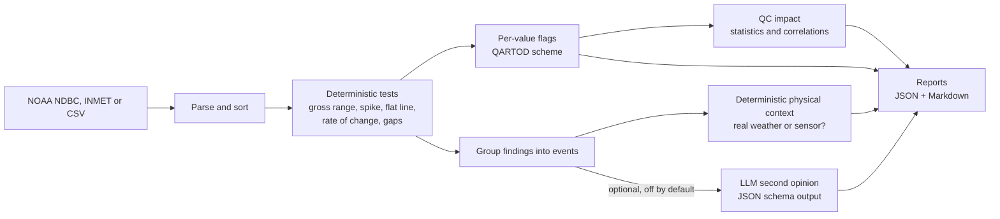

# metocean-qc

[Português](README.md) · **English**

Quality control for meteorological and ocean time series from buoys and weather stations.
Deterministic tests decide the flags; an **optional** LLM gives a second opinion on each event,
whether it looks like a sensor fault, a real environmental event, or cannot be told, and a person decides.

[](https://github.com/hnryguchi/metocean-qc/actions/workflows/ci.yml) [](https://github.com/hnryguchi/metocean-qc/actions/workflows/live.yml)

[](https://codespaces.new/hnryguchi/metocean-qc?quickstart=1)

## Why

Station data is full of things that look wrong: frozen sensors, single-point jumps, transmission gaps.
Some of them are real. A pressure drop that comes with rising wind is a front, not a broken barometer.
Fixed thresholds catch the first kind well and the second kind badly. This tool keeps the thresholds
in charge of the flags, and uses the other variables recorded at the same time to explain each alert.

## Running every day

A scheduled GitHub Action fetches the latest NOAA data for three buoys, runs the deterministic tests (no LLM)
and publishes an **interactive dashboard** at [hnryguchi.github.io/metocean-qc](https://hnryguchi.github.io/metocean-qc/):
buoy map, latest readings with flags, a time series per variable with flagged points and gaps, an events table
and a description of the tests (PT/EN). The site is built by `metqc site`.

<a href="https://hnryguchi.github.io/metocean-qc/"></a>

The buoys are in [`stations.geojson`](stations.geojson), which GitHub shows as an interactive map.

**Try it without installing anything:** the Codespaces button above opens a ready environment that
fetches buoy 41010 and writes the report and card on start.

## What is different

Good QC tools already exist: [ioos_qc](https://github.com/ioos/ioos_qc) (the official implementation of the QARTOD
tests), [CoTeDe](https://github.com/castelao/CoTeDe) (oceanographic profiles) and
[SaQC](https://rdm-software.pages.ufz.de/saqc/) (environmental time series). The threshold tests here are simpler
versions of theirs. metocean-qc differs in three ways:

| | metocean-qc | ioos_qc / CoTeDe / SaQC |
|---|---|---|
| **Physical explanation of each alert** | Yes, deterministic: it checks what the other variables did and labels the event as likely real weather (cold front, shower, gust) or a likely sensor fault | They flag the value; interpretation is left to the analyst |
| **QC impact on the numbers** | Reports how much means, extremes and correlations between variables change when flagged values are removed | Not provided |
| **INMET stations (Brazil)** | Reads the official historical files directly (decimal comma, -9999, two date formats, station-level pressure) | Need prior conversion |
| Daily run with a published dashboard | Yes (GitHub Actions + GitHub Pages) | Not the focus |
| Dependencies | None (standard library only) | numpy/pandas and others |

The question behind the impact report is the one that matters in a climate study: if a few bad values move a mean or
a correlation, a conclusion drawn from the raw series is not robust.

## How it works



- **Flags** follow the [IOOS QARTOD](https://ioos.noaa.gov/project/qartod/) scheme: 1 good, 2 not evaluated, 3 suspect, 4 fail, 9 missing. The test families are simplified versions of QARTOD tests. This is not a certified QARTOD implementation.
- **Tests**:
  - gross range (physical limits → fail, climatological limits → suspect);
  - spike (deviation from the neighbour mean, flagged only at the local maximum so the values next to a spike are not flagged);
  - flat line (unchanged value for N hours; values on a physical bound, such as calm wind or saturated air, do not count);
  - rate of change (sustained change over about 1 hour, compared with the value 1 hour earlier, not the previous record);
  - gaps between records (in INMET files, an hour with every variable at -9999 counts as no record).
- **Limits scaled by the record interval**: spike limits were calibrated on 10-minute data and grow with the square root of the interval (hourly data: x2.45), because the weather moves more between two records an hour apart.
- **Events** merge nearby findings of the same variable, so a frozen sensor is one alert, not 80.
- **Physical context** (`context.py`) labels each event from the other variables within ±3 h, using meteorology rules:
  a pressure fall or rise with stronger wind or cooling → front passage; cooling with rising humidity or rain → shower or
  downdraft; a value stuck while the rest of the station varies → likely stuck sensor; a one-point jump that no other
  variable follows → likely sensor. The label never changes a flag.
- **QC impact** (`impact.py`) compares mean, standard deviation, minimum, maximum and the Pearson correlations between
  pairs of variables on the raw series and on the series without flagged values (FAIL only, and FAIL + SUSPECT).
- **LLM review** (`--review claude`) sends each event with a ±6 h window of *all* variables and asks for a verdict, confidence, evidence and a recommended action. Output is constrained to a JSON schema. A refusal becomes "uncertain, needs human review". It never changes flags.

## Quick start

```bash
pip install -e .                       # no runtime dependencies (standard library only)
metqc check INMET_SE_RJ_A619_PARATY_01-01-2024_A_31-12-2024.CSV --source inmet --out reports/A619   # INMET station
metqc fetch 41010                      # last ~45 days from NOAA NDBC buoy 41010 (public domain)
metqc check data/41010.txt --out reports/41010
metqc check data/41010.txt --out reports/41010 --card reports/41010/status.svg   # + SVG status card
```

CSV input (one ISO-8601 time column, one column per variable; `temperatura`, `umidade`, `pressao`, `temperature`, `humidity` and `pressure` are mapped automatically):

```bash
metqc check station.csv --source csv --time-column timestamp
```

Optional LLM second opinion (**paid API**, capped at `--max-reviews`, default 10 events per run):

```bash
pip install -e ".[llm]"
export ANTHROPIC_API_KEY=...           # never commit keys; the code reads them from the environment
metqc check data/41010.txt --review claude --max-reviews 5
```

## Results on real data

Tested on NOAA NDBC realtime files fetched on 2026-11-19 (about 45 days, 10-minute records):

| Station | Records | Values flagged | Events | What the events were |
|---|---|---|---|---|
| 41010 (off Cape Canaveral) | 6,347 | 12 | 2 | water temperature unchanged for 24 h (suspect), one 9 h transmission gap |
| 44013 (Boston approach) | 6,345 | 3 | 3 | two single-point air temperature and dew point spikes (suspect), one gap |
| 46042 (Monterey Bay) | 6,343 | 3 | 3 | dew point and wave height spikes (suspect), one gap |

**The first version produced false positives, and the data exposed them.** Station 41010 produced 97 flagged values,
including FAIL flags for water temperature "frozen" for 12 to 25 hours. Inspecting the series showed
these were not faults: NDBC reports water temperature in 0.1 °C and wind speed in whole m/s, and a
stable tropical sea or a steady trade wind repeats the same value for many hours. The flat-line
thresholds were retuned to the sensor resolution (e.g. water temperature: suspect after 24 h, fail
after 72 h), and the reasoning is documented in [`src/metqc/config.py`](src/metqc/config.py).

Example report: [`examples/41010/qc_report.md`](examples/41010/qc_report.md).

### INMET stations (real 2024 data)

Tested on the official 2024 historical files of two automatic stations in Rio de Janeiro state (8,784 hourly
records each; a full year runs in about 6 seconds):

| Station | Events | What showed up |
|---|---|---|
| A619 Paraty | 4 | a dew-point drop together with cooling and rising humidity (labelled a likely shower), two humidity and dew-point jumps with no clear physical signature, and one period of unchanged humidity |
| A608 Macaé | 37 | 36 transmission outages, 26 of them in February: the station spent weeks sending only a few hours a day (883 hours without data in the year, the longest gap 8 days) |

**Real data changed the rules, again.** The first INMET version produced 142 and 148 events, nearly all false:
1. humidity held at 95–98 % for more than 12 h during night rain became a FAIL. That is saturated air: capacitive sensors
   settle a few points below 100 %. Runs at 94 % or more are no longer flat-line tested;
2. a fall from 30.8 to 25.2 °C with 7.2 mm of rain became a spike FAIL. The limits were for 10-minute data and now scale
   with the interval;
3. a value isolated between hours without data was compared with neighbours hours away. Neighbours more than 3 h away
   are no longer used.

The other way round, the Macaé outage did not show up, because INMET keeps the hourly row and fills the values with -9999.

## Project layout

```
src/metqc/
  models.py    Series, Flag (QARTOD values), Finding
  sources.py   NDBC realtime parser and fetcher, INMET reader, CSV reader
  config.py    default limits per variable, with the reasoning behind them
  rules.py     deterministic tests (no side effects)
  engine.py    runs tests, keeps the worst flag per value, groups events
  context.py   deterministic physical context of each event (real weather or sensor?)
  impact.py    QC impact on means, extremes and correlations
  review.py    optional LLM reviewer (Claude), prompt and JSON schema
  report.py    JSON and Markdown reports
  card.py      SVG status card (latest readings, 72 h chart with flagged points)
  site.py      static dashboard: QC per station, browser JSON, reports and cards
  site/        dashboard front end (Plotly + Leaflet)
  cli.py       metqc fetch / metqc check [--card]
tests/         pytest; real NDBC sample + clearly labelled synthetic series; fake LLM client
```

## Development

```bash
python -m venv .venv && . .venv/bin/activate      # Windows: .venv\Scripts\activate
pip install -e ".[dev]"
pytest -q && ruff check src tests
```

CI runs lint and tests on Python 3.10 to 3.13. No test calls a paid API: the LLM layer is tested with a fake client.
A live `--review claude` run has not been executed yet (no API key on the development machine). The request
shape was checked against the installed `anthropic` SDK signature only.

## Limitations and next steps

- Default thresholds are global and broad. Real use needs per-station, per-season limits (e.g. from climatology).
- The physical-context rules are few and conservative; many events stay "undetermined". They have not yet been
  evaluated against events labelled by meteorologists.
- There is no automatic INMET download yet: the yearly file is downloaded by hand from the portal.
- Next: PNBOIA and PIRATA buoys, per-station limits from the series' own climatology, comparison with neighbouring
  stations, and an evaluation set of human-labelled events.

## Data and license

- NOAA NDBC data is public domain (U.S. Government work). The test fixture is a 150-record excerpt of station 41010.
- INMET data is public ([portal.inmet.gov.br/dadoshistoricos](https://portal.inmet.gov.br/dadoshistoricos)). Tests use a synthetic excerpt in the same format, labelled as such.
- Code: © Henry Noguchi. All rights reserved; see [LICENSE](LICENSE).
