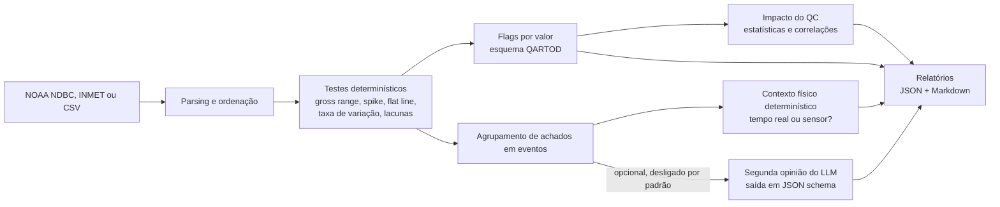

# metocean-qc

**Português** · [English](README.en.md)

Controle de qualidade de séries temporais meteorológicas e oceanográficas de boias e estações meteorológicas.
Testes determinísticos decidem os flags; um LLM **opcional** dá uma segunda opinião sobre cada evento
(falha de sensor, evento ambiental real ou indeterminado), e a decisão final é de uma pessoa.

[](https://github.com/hnryguchi/metocean-qc/actions/workflows/ci.yml) [](https://github.com/hnryguchi/metocean-qc/actions/workflows/live.yml)

[](https://codespaces.new/hnryguchi/metocean-qc?quickstart=1)

## Motivação

Dados de estações estão cheios de valores que parecem errados: sensores travados, saltos de um único ponto, falhas de transmissão.
Alguns deles são reais. Uma queda de pressão acompanhada de aumento do vento é uma frente, não um barômetro quebrado.
Limiares fixos detectam bem o primeiro tipo e mal o segundo. Esta ferramenta mantém os limiares como única fonte
dos flags e usa as demais variáveis registradas no mesmo instante para explicar cada alerta.

## Execução diária

Uma GitHub Action agendada baixa os dados mais recentes da NOAA para três boias, roda os testes determinísticos
(sem LLM) e publica um **dashboard interativo** em [hnryguchi.github.io/metocean-qc](https://hnryguchi.github.io/metocean-qc/):
mapa das boias, últimas leituras com flag, série temporal de cada variável com os pontos sinalizados e as lacunas,
tabela de eventos e descrição dos testes (PT/EN). O comando que gera o site é `metqc site`.

<a href="https://hnryguchi.github.io/metocean-qc/"></a>

As boias estão em [`stations.geojson`](stations.geojson), que o GitHub renderiza como mapa interativo.

**Teste sem instalar nada:** o botão do Codespaces acima abre um ambiente pronto que baixa a boia 41010
e gera o relatório e o card na inicialização.

## O que tem de diferente

Já existem boas ferramentas de controle de qualidade: o [ioos_qc](https://github.com/ioos/ioos_qc) (a implementação
oficial dos testes QARTOD), o [CoTeDe](https://github.com/castelao/CoTeDe) (perfis oceanográficos) e o
[SaQC](https://rdm-software.pages.ufz.de/saqc/) (séries ambientais). Os testes de limite daqui são versões mais simples
dos testes delas. O metocean-qc se diferencia em três pontos:

| | metocean-qc | ioos_qc / CoTeDe / SaQC |
|---|---|---|
| **Explicação física de cada alerta** | Sim, determinística: olha o que as outras variáveis fizeram e rotula o evento como provável tempo real (frente fria, pancada de chuva, rajada) ou provável defeito de sensor | Marcam o valor; a interpretação fica com quem analisa |
| **Impacto do QC nos números** | Relatório de quanto médias, extremos e correlações entre variáveis mudam ao remover os valores marcados | Não fazem |
| **Estações do INMET** | Lê os arquivos históricos oficiais direto (vírgula decimal, -9999, dois formatos de data, pressão ao nível da estação) | Exigem conversão prévia |
| Execução diária com painel publicado | Sim (GitHub Actions + GitHub Pages) | Não é o foco |
| Dependências | Nenhuma (só biblioteca padrão) | numpy/pandas e outras |

A pergunta por trás do relatório de impacto é a que importa num estudo de clima: se alguns valores ruins mudam uma
média ou uma correlação, uma conclusão tirada da série bruta não é robusta.

## Como funciona



- **Flags** seguem o esquema do [IOOS QARTOD](https://ioos.noaa.gov/project/qartod/): 1 bom, 2 não avaliado, 3 suspeito, 4 falha, 9 ausente. As famílias de testes são versões simplificadas dos testes QARTOD. Esta não é uma implementação certificada do QARTOD.
- **Testes**:
  - gross range (limites físicos → falha, limites climatológicos → suspeito);
  - spike (desvio em relação à média dos vizinhos, sinalizado apenas no máximo local, para que os valores adjacentes a um spike não sejam sinalizados);
  - flat line (valor inalterado por N horas; valores no limite físico, como vento calmo ou umidade saturada, não contam);
  - taxa de variação (mudança sustentada em cerca de 1 hora, comparada com o valor de 1 hora antes, não com o registro anterior);
  - lacunas entre registros (no INMET, uma hora com todas as variáveis em -9999 conta como sem registro).
- **Limites escalados pelo intervalo**: os limites de spike foram calibrados para dados de 10 minutos e crescem com a raiz do intervalo (dados horários: ×2,45), porque o tempo muda mais entre dois registros com 1 hora de distância.
- **Eventos** agrupam achados próximos da mesma variável, de modo que um sensor travado gera um alerta, não 80.
- **Contexto físico** (`context.py`) rotula cada evento a partir das outras variáveis em ±3 h, com regras de meteorologia:
  queda ou subida de pressão com vento mais forte ou resfriamento → passagem de frente; resfriamento com umidade subindo ou
  chuva → pancada ou corrente descendente; valor parado enquanto o resto da estação varia → provável sensor travado;
  salto de um ponto que nenhuma outra variável acompanha → provável sensor. O rótulo nunca altera o flag.
- **Impacto do QC** (`impact.py`) compara média, desvio, mínimo, máximo e as correlações de Pearson entre pares de variáveis
  na série bruta e na série sem os valores marcados (só FAIL, e FAIL + SUSPECT).
- **Revisão por LLM** (`--review claude`) envia cada evento com uma janela de ±6 h de *todas* as variáveis e solicita veredito, grau de confiança, evidências e ação recomendada. A saída é restrita a um JSON schema. Uma recusa vira "incerto, requer revisão humana". A revisão nunca altera os flags.

## Início rápido

```bash
pip install -e .                       # sem dependências de runtime (apenas biblioteca padrão)
metqc check INMET_SE_RJ_A619_PARATY_01-01-2024_A_31-12-2024.CSV --source inmet --out reports/A619   # estação do INMET
metqc fetch 41010                      # últimos ~45 dias da boia 41010 do NOAA NDBC (domínio público)
metqc check data/41010.txt --out reports/41010
metqc check data/41010.txt --out reports/41010 --card reports/41010/status.svg   # + card SVG de status
```

Entrada CSV (uma coluna de tempo em ISO-8601, uma coluna por variável; `temperatura`, `umidade`, `pressao`, `temperature`, `humidity` e `pressure` são mapeadas automaticamente):

```bash
metqc check station.csv --source csv --time-column timestamp
```

Segunda opinião opcional do LLM (**API paga**, limitada por `--max-reviews`, padrão de 10 eventos por execução):

```bash
pip install -e ".[llm]"
export ANTHROPIC_API_KEY=...           # nunca versione chaves; o código as lê do ambiente
metqc check data/41010.txt --review claude --max-reviews 5
```

## Resultados com dados reais

Testado com arquivos realtime do NOAA NDBC baixados em 2026-11-19 (cerca de 45 dias, registros a cada 10 minutos):

| Estação | Registros | Valores sinalizados | Eventos | O que foram os eventos |
|---|---|---|---|---|
| 41010 (ao largo de Cape Canaveral) | 6,347 | 12 | 2 | temperatura da água inalterada por 24 h (suspeito), uma lacuna de transmissão de 9 h |
| 44013 (aproximação de Boston) | 6,345 | 3 | 3 | dois spikes de um único ponto em temperatura do ar e ponto de orvalho (suspeito), uma lacuna |
| 46042 (Baía de Monterey) | 6,343 | 3 | 3 | spikes em ponto de orvalho e altura de onda (suspeito), uma lacuna |

**A primeira versão gerava falsos positivos, e os dados os expuseram.** A estação 41010 gerou 97 valores sinalizados,
incluindo flags FAIL para temperatura da água "travada" por 12 a 25 horas. A inspeção da série mostrou que não
eram falhas: o NDBC reporta a temperatura da água com resolução de 0,1 °C e a velocidade do vento em m/s inteiros, e
um mar tropical estável ou um alísio constante repete o mesmo valor por muitas horas. Os limiares de flat line
foram reajustados à resolução do sensor (por exemplo, temperatura da água: suspeito após 24 h, falha
após 72 h), e o raciocínio está documentado em [`src/metqc/config.py`](src/metqc/config.py).

Relatório de exemplo: [`examples/41010/qc_report.md`](examples/41010/qc_report.md).

### Estações do INMET (dados reais de 2024)

Testado com os arquivos históricos oficiais de 2024 de duas estações automáticas do RJ (8.784 registros horários cada;
um ano inteiro roda em cerca de 6 segundos):

| Estação | Eventos | O que apareceu |
|---|---|---|
| A619 Paraty | 4 | uma queda de ponto de orvalho junto com resfriamento e umidade subindo (rotulada como pancada de chuva provável), dois saltos de umidade e ponto de orvalho sem assinatura física clara e um período de umidade parada |
| A608 Macaé | 37 | 36 interrupções de transmissão, 26 delas em fevereiro: a estação passou semanas enviando só algumas horas por dia (883 horas sem dado no ano, a maior lacuna com 8 dias) |

**Os dados reais mudaram as regras, de novo.** A primeira versão para o INMET gerou 142 e 148 eventos, quase todos falsos:
1. umidade parada em 95–98 % por mais de 12 h durante chuva noturna virava FAIL. É ar saturado: sensores capacitivos estabilizam
   alguns pontos abaixo de 100 %. Sequências a partir de 94 % não entram mais no teste de flat line;
2. uma queda de 30,8 para 25,2 °C com 7,2 mm de chuva virava FAIL de spike. Os limites eram de dados de 10 minutos e agora
   escalam com o intervalo;
3. um valor isolado entre horas sem dado era comparado com vizinhos de horas antes ou depois. Vizinhos a mais de 3 h não
   são mais usados.

Na direção oposta, a lacuna de Macaé não aparecia, porque o INMET mantém a linha da hora e preenche os valores com -9999.

## Estrutura do projeto

```
src/metqc/
  models.py    Series, Flag (valores QARTOD), Finding
  sources.py   parser e downloader de arquivos realtime do NDBC, leitor do INMET, leitor de CSV
  config.py    limites padrão por variável, com a justificativa de cada um
  rules.py     testes determinísticos (sem efeitos colaterais)
  engine.py    executa os testes, mantém o pior flag por valor, agrupa eventos
  context.py   contexto físico determinístico de cada evento (tempo real ou sensor?)
  impact.py    impacto do QC em médias, extremos e correlações
  review.py    revisor opcional por LLM (Claude), prompt e JSON schema
  report.py    relatórios em JSON e Markdown
  card.py      card SVG de status (últimas leituras, gráfico de 72 h com pontos sinalizados)
  site.py      dashboard estático: QC por estação, JSON para o navegador, relatórios e cards
  site/        front-end do dashboard (Plotly + Leaflet)
  cli.py       metqc fetch / metqc check [--card]
tests/         pytest; amostra real do NDBC + séries sintéticas claramente identificadas; cliente LLM falso
```

## Desenvolvimento

```bash
python -m venv .venv && . .venv/bin/activate      # Windows: .venv\Scripts\activate
pip install -e ".[dev]"
pytest -q && ruff check src tests
```

O CI roda lint e testes em Python 3.10 a 3.13. Nenhum teste chama API paga: a camada de LLM é testada com um cliente falso.
Uma execução real com `--review claude` ainda não foi feita (não há chave de API na máquina de desenvolvimento). O formato
da requisição foi conferido apenas contra a assinatura do SDK `anthropic` instalado.

## Limitações e próximos passos

- Os limiares padrão são globais e amplos. O uso real exige limites por estação e por época do ano (por exemplo, derivados de climatologia).
- As regras de contexto físico são poucas e conservadoras; muitos eventos ficam como "indeterminado". Ainda não foram avaliadas
  contra eventos rotulados por meteorologistas.
- O download automático do INMET ainda não existe: o arquivo anual é baixado à mão no portal.
- Próximos passos: boias do PNBOIA e da rede PIRATA, limites por estação a partir da climatologia da própria série,
  comparação com estações vizinhas e um conjunto de avaliação com eventos rotulados por pessoas.

## Dados e licença

- Os dados do NOAA NDBC são de domínio público (obra do governo dos EUA). A fixture de teste é um trecho de 150 registros da estação 41010.
- Os dados do INMET são públicos ([portal.inmet.gov.br/dadoshistoricos](https://portal.inmet.gov.br/dadoshistoricos)). Os testes usam um trecho sintético no mesmo formato, identificado como tal.
- Código: © Henry Noguchi. Todos os direitos reservados; ver [LICENSE](LICENSE).
