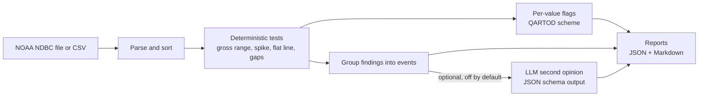

# metocean-qc

Quality control for meteorological and ocean time series from buoys and weather stations.
Deterministic tests decide the flags; an **optional** LLM gives a second opinion on each event,
whether it looks like a sensor fault, a real environmental event, or cannot be told, and a person decides.

[](https://github.com/hnryguchi/metocean-qc/actions/workflows/ci.yml)

## Why

Station data is full of things that look wrong: frozen sensors, single-point jumps, transmission gaps.
Some of them are real. A pressure drop that comes with rising wind is a front, not a broken barometer.
Fixed thresholds catch the first kind well and the second kind badly. This tool keeps the thresholds
in charge of the flags, and uses the other variables recorded at the same time to explain each alert.

## How it works



- **Flags** follow the [IOOS QARTOD](https://ioos.noaa.gov/project/qartod/) scheme: 1 good, 2 not evaluated, 3 suspect, 4 fail, 9 missing. The test families are simplified versions of QARTOD tests. This is not a certified QARTOD implementation.
- **Tests**:
  - gross range (physical limits → fail, climatological limits → suspect);
  - spike (deviation from the neighbour mean, flagged only at the local maximum so the values next to a spike are not flagged);
  - flat line (unchanged value for N hours);
  - gaps between records.
- **Events** merge nearby findings of the same variable, so a frozen sensor is one alert, not 80.
- **LLM review** (`--review claude`) sends each event with a ±6 h window of *all* variables and asks for a verdict, confidence, evidence and a recommended action. Output is constrained to a JSON schema. A refusal becomes "uncertain, needs human review". It never changes flags.

## Quick start

```bash
pip install -e .                       # no runtime dependencies (standard library only)
metqc fetch 41010                      # last ~45 days from NOAA NDBC buoy 41010 (public domain)
metqc check data/41010.txt --out reports/41010
```

CSV input (one ISO-8601 time column, one column per variable; `temperatura`, `umidade`, `pressao`, `temperature`, `humidity` and `pressure` are mapped automatically):

```bash
metqc check station.csv --source csv --time-column timestamp
```

Optional LLM second opinion (**paid API**, capped at `--max-reviews`, default 10 events per run):

```bash
pip install -e ".[llm]"
export ANTHROPIC_API_KEY=...           # never commit keys; the code reads them from the environment
metqc check data/41010.txt --review claude --max-reviews 5
```

## Results on real data

Tested on NOAA NDBC realtime files fetched on 2026-11-19 (about 45 days, 10-minute records):

| Station | Records | Values flagged | Events | What the events were |
|---|---|---|---|---|
| 41010 (off Cape Canaveral) | 6,347 | 12 | 2 | water temperature unchanged for 24 h (suspect), one 9 h transmission gap |
| 44013 (Boston approach) | 6,345 | 3 | 3 | two single-point air temperature and dew point spikes (suspect), one gap |
| 46042 (Monterey Bay) | 6,343 | 3 | 3 | dew point and wave height spikes (suspect), one gap |

**The first version was wrong, and the data showed it.** Station 41010 produced 97 flagged values,
including FAIL flags for water temperature "frozen" for 12 to 25 hours. Looking at the series showed
these were not faults: NDBC reports water temperature in 0.1 °C and wind speed in whole m/s, and a
stable tropical sea or a steady trade wind repeats the same value for many hours. The flat-line
thresholds were retuned to the sensor resolution (e.g. water temperature: suspect after 24 h, fail
after 72 h), and the reasoning is documented in [`src/metqc/config.py`](src/metqc/config.py).

Example report: [`examples/41010/qc_report.md`](examples/41010/qc_report.md).

## Project layout

```
src/metqc/
  models.py    Series, Flag (QARTOD values), Finding
  sources.py   NDBC realtime parser and fetcher, CSV reader
  config.py    default limits per variable, with the reasoning behind them
  rules.py     deterministic tests (no side effects)
  engine.py    runs tests, keeps the worst flag per value, groups events
  review.py    optional LLM reviewer (Claude), prompt and JSON schema
  report.py    JSON and Markdown reports
  cli.py       metqc fetch / metqc check
tests/         pytest; real NDBC sample + clearly labelled synthetic series; fake LLM client
```

## Development

```bash
python -m venv .venv && . .venv/bin/activate      # Windows: .venv\Scripts\activate
pip install -e ".[dev]"
pytest -q && ruff check src tests
```

CI runs lint and tests on Python 3.10 to 3.13. No test calls a paid API: the LLM layer is tested with a fake client.
A live `--review claude` run has not been executed yet (no API key on the development machine). The request
shape was checked against the installed `anthropic` SDK signature only.

## Limitations and next steps

- Default thresholds are global and broad. Real use needs per-station, per-season limits (e.g. from climatology).
- No rate-of-change test or multi-variate tests yet; the cross-variable reasoning is only in the optional LLM step.
- Next: Brazilian sources (INMET automatic stations, PNBOIA buoys), a configurable limits file, and an evaluation
  set of human-labelled events to measure whether the LLM second opinion actually helps.

## Data and license

- NOAA NDBC data is public domain (U.S. Government work). The test fixture is a 150-record excerpt of station 41010.
- Code: MIT. Author: Henry Noguchi.
