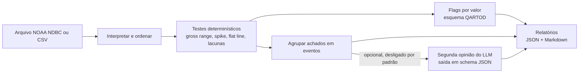

# metocean-qc

[English](README.md) · **Português**

Controle de qualidade para séries temporais meteorológicas e oceânicas de boias e estações meteorológicas.
Testes determinísticos decidem os flags; um LLM **opcional** dá uma segunda opinião sobre cada evento,
se parece uma falha de sensor, um evento ambiental real ou se não é possível dizer, e uma pessoa decide.

[](https://github.com/hnryguchi/metocean-qc/actions/workflows/ci.yml) [](https://github.com/hnryguchi/metocean-qc/actions/workflows/live.yml)

[](https://codespaces.new/hnryguchi/metocean-qc?quickstart=1)

## Por quê

Dados de estações estão cheios de coisas que parecem erradas: sensores travados, saltos de um único ponto, falhas de transmissão.
Algumas delas são reais. Uma queda de pressão acompanhada de aumento do vento é uma frente, não um barômetro quebrado.
Limiares fixos pegam bem o primeiro tipo e mal o segundo. Esta ferramenta deixa os limiares no comando
dos flags e usa as outras variáveis registradas no mesmo momento para explicar cada alerta.

## Rodando todo dia

Uma GitHub Action agendada baixa os dados mais recentes da NOAA para três boias, roda os testes determinísticos
(sem LLM) e publica o resultado em [hnryguchi.github.io/metocean-qc/](https://hnryguchi.github.io/metocean-qc/):

<a href="https://hnryguchi.github.io/metocean-qc/"></a>

As boias estão em [`stations.geojson`](stations.geojson), que o GitHub mostra como mapa interativo.

**Teste sem instalar nada:** o botão do Codespaces acima abre um ambiente pronto que baixa a boia 41010
e gera o relatório e o card ao iniciar.

## Como funciona



- **Flags** seguem o esquema do [IOOS QARTOD](https://ioos.noaa.gov/project/qartod/): 1 bom, 2 não avaliado, 3 suspeito, 4 falha, 9 ausente. As famílias de testes são versões simplificadas dos testes do QARTOD. Esta não é uma implementação certificada do QARTOD.
- **Testes**:
  - gross range (limites físicos → falha, limites climatológicos → suspeito);
  - spike (desvio em relação à média dos vizinhos, sinalizado apenas no máximo local, para que os valores ao lado de um spike não sejam sinalizados);
  - flat line (valor inalterado por N horas);
  - lacunas entre registros.
- **Eventos** juntam achados próximos da mesma variável, de modo que um sensor travado é um alerta, não 80.
- **Revisão por LLM** (`--review claude`) envia cada evento com uma janela de ±6 h de *todas* as variáveis e pede um veredito, um grau de confiança, as evidências e uma ação recomendada. A saída é restrita a um schema JSON. Uma recusa vira "incerto, precisa de revisão humana". Ela nunca altera os flags.

## Início rápido

```bash
pip install -e .                       # no runtime dependencies (standard library only)
metqc fetch 41010                      # last ~45 days from NOAA NDBC buoy 41010 (public domain)
metqc check data/41010.txt --out reports/41010
metqc check data/41010.txt --out reports/41010 --card reports/41010/status.svg   # + card SVG de status
```

Entrada CSV (uma coluna de tempo em ISO-8601, uma coluna por variável; `temperatura`, `umidade`, `pressao`, `temperature`, `humidity` e `pressure` são mapeadas automaticamente):

```bash
metqc check station.csv --source csv --time-column timestamp
```

Segunda opinião opcional do LLM (**API paga**, limitada por `--max-reviews`, padrão de 10 eventos por execução):

```bash
pip install -e ".[llm]"
export ANTHROPIC_API_KEY=...           # never commit keys; the code reads them from the environment
metqc check data/41010.txt --review claude --max-reviews 5
```

## Resultados com dados reais

Testado com arquivos em tempo real do NOAA NDBC baixados em 2026-11-19 (cerca de 45 dias, registros a cada 10 minutos):

| Estação | Registros | Valores sinalizados | Eventos | O que foram os eventos |
|---|---|---|---|---|
| 41010 (ao largo de Cape Canaveral) | 6,347 | 12 | 2 | temperatura da água inalterada por 24 h (suspeito), uma lacuna de transmissão de 9 h |
| 44013 (aproximação de Boston) | 6,345 | 3 | 3 | dois spikes de um único ponto em temperatura do ar e ponto de orvalho (suspeito), uma lacuna |
| 46042 (Baía de Monterey) | 6,343 | 3 | 3 | spikes em ponto de orvalho e altura de onda (suspeito), uma lacuna |

**A primeira versão estava errada, e os dados mostraram isso.** A estação 41010 gerou 97 valores sinalizados,
incluindo flags de FALHA para temperatura da água "travada" por 12 a 25 horas. Olhando a série, ficou claro
que não eram falhas: o NDBC reporta a temperatura da água em 0,1 °C e a velocidade do vento em m/s inteiros, e um
mar tropical estável ou um vento alísio constante repete o mesmo valor por muitas horas. Os limiares de flat line
foram reajustados para a resolução do sensor (por exemplo, temperatura da água: suspeito após 24 h, falha
após 72 h), e o raciocínio está documentado em [`src/metqc/config.py`](src/metqc/config.py).

Relatório de exemplo: [`examples/41010/qc_report.md`](examples/41010/qc_report.md).

## Estrutura do projeto

```
src/metqc/
  models.py    Series, Flag (QARTOD values), Finding
  sources.py   NDBC realtime parser and fetcher, CSV reader
  config.py    default limits per variable, with the reasoning behind them
  rules.py     deterministic tests (no side effects)
  engine.py    runs tests, keeps the worst flag per value, groups events
  review.py    optional LLM reviewer (Claude), prompt and JSON schema
  report.py    JSON and Markdown reports
  card.py      card SVG de status (últimas leituras, gráfico de 72 h com pontos sinalizados)
  cli.py       metqc fetch / metqc check [--card]
tests/         pytest; real NDBC sample + clearly labelled synthetic series; fake LLM client
```

## Desenvolvimento

```bash
python -m venv .venv && . .venv/bin/activate      # Windows: .venv\Scripts\activate
pip install -e ".[dev]"
pytest -q && ruff check src tests
```

O CI roda lint e testes em Python 3.10 a 3.13. Nenhum teste chama uma API paga: a camada de LLM é testada com um cliente falso.
Uma execução real com `--review claude` ainda não foi feita (não há chave de API na máquina de desenvolvimento). O formato
da requisição foi conferido apenas contra a assinatura do SDK `anthropic` instalado.

## Limitações e próximos passos

- Os limiares padrão são globais e amplos. O uso real exige limites por estação e por estação do ano (por exemplo, a partir da climatologia).
- Ainda não há teste de taxa de variação nem testes multivariados; o raciocínio entre variáveis está apenas na etapa opcional de LLM.
- Próximos passos: fontes brasileiras (estações automáticas do INMET, boias do PNBOIA), um arquivo de limites configurável e um conjunto
  de avaliação com eventos rotulados por pessoas, para medir se a segunda opinião do LLM realmente ajuda.

## Dados e licença

- Os dados do NOAA NDBC são de domínio público (obra do governo dos EUA). A fixture de teste é um trecho de 150 registros da estação 41010.
- Código: MIT. Autor: Henry Noguchi.
